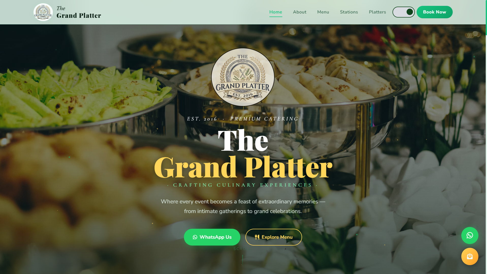
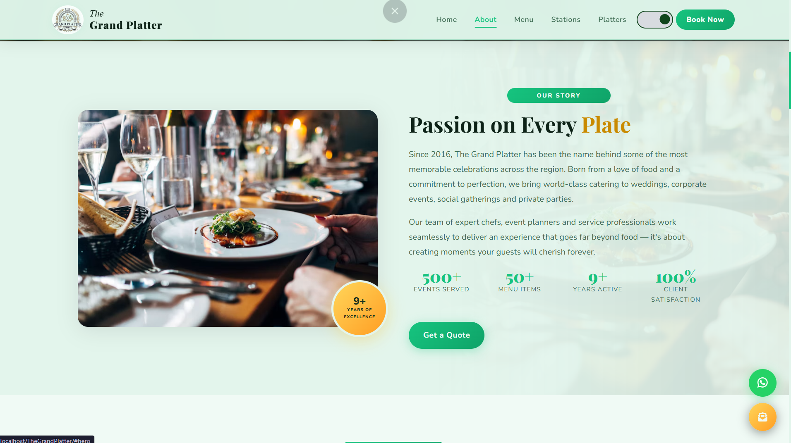
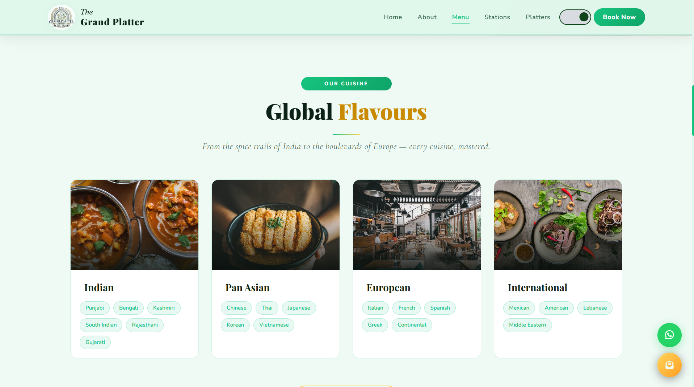
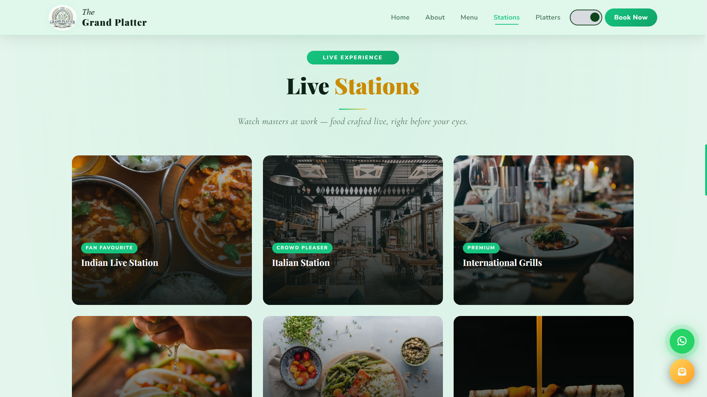
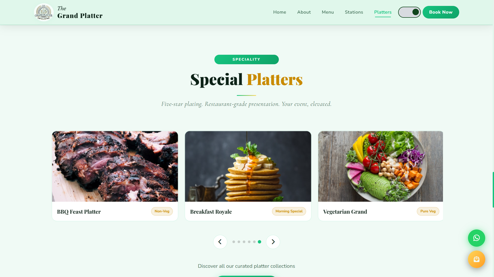
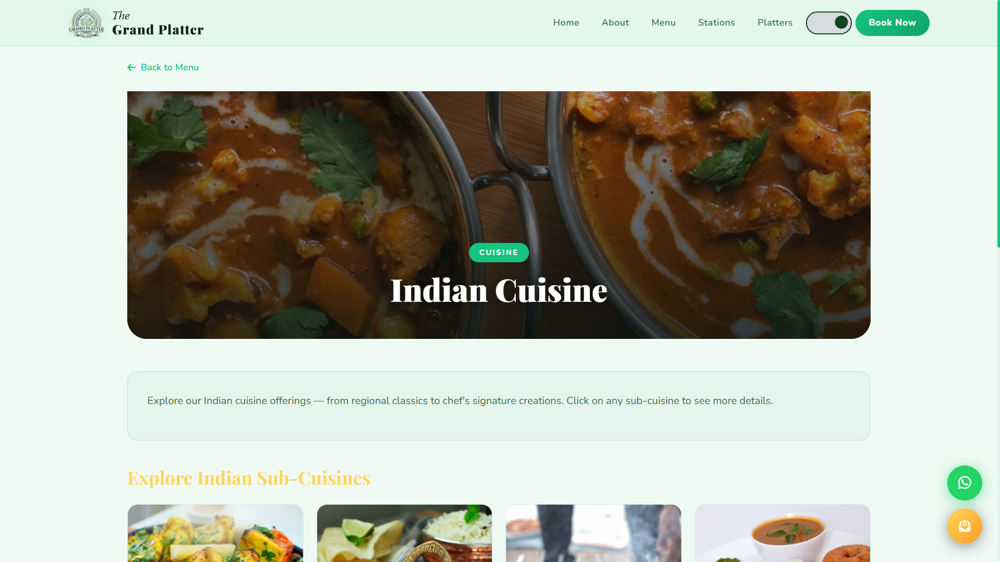
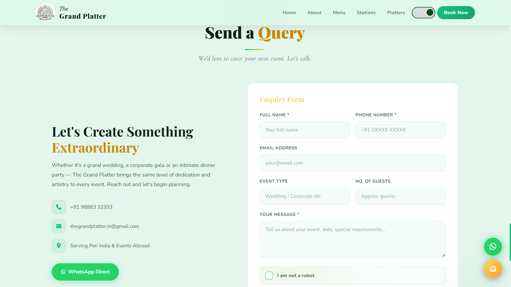
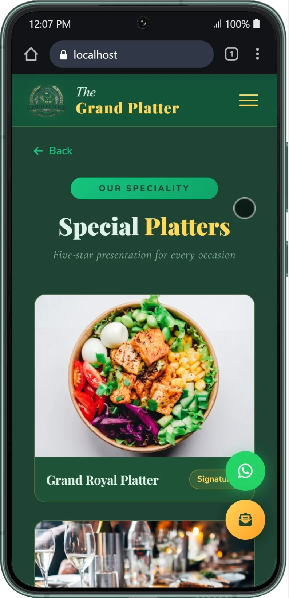

# The Grand Platter

### Premium Catering Website

A responsive catering showcase for exploring cuisines, live food stations, and curated platters — with direct WhatsApp enquiry support.

[Features](#-features) · [Screenshots](#-screenshots) · [Tech Stack](#-tech-stack) · [Run Locally](#-getting-started) · [Project Structure](#-project-structure)

---

## Overview

**The Grand Platter** is a multi-section website concept for a premium catering business. It presents the business, showcases its cuisine categories and catering stations, highlights special platter collections, and gives visitors a way to send event enquiries through WhatsApp.

The landing page is built with HTML, CSS, and vanilla JavaScript. A PHP-powered detail page reads URL query parameters and uses the shared JavaScript data to render cuisine, station, and platter information.

## ✨ Features

- **Responsive landing page** — sections for the hero, about, menu, live stations, special platters, and contact/enquiry.
- **Cuisine discovery** — Indian, Pan Asian, European, and International categories with sub-cuisine links.
- **Live station showcase** — dedicated detail views for 12 catering stations.
- **Special platters** — featured platter carousel with touch/swipe support.
- **Dynamic detail pages** — PHP passes URL parameters to JavaScript to render the relevant cuisine, station, or platter content.
- **WhatsApp enquiries** — validates required fields and opens WhatsApp with a pre-filled enquiry message.
- **Theme switcher** — light/dark appearance preference is saved in browser local storage.
- **Responsive navigation** — desktop navigation and mobile menu.
- **Motion and interaction** — scroll-triggered reveal effects, animated counters, smooth anchor scrolling, and floating quick-action controls.
- **Reusable menu data** — cuisine, station, and platter content is maintained centrally in `js/data.js`.

## 🖼️ Screenshots

### 1. Homepage / Hero

### 2. About section

### 3. Cuisine categories

### 4. Live catering stations

### 5. Special platters

### 6. Dynamic detail page

### 7. Enquiry and contact section

### 8. Mobile layout

## 🧰 Tech Stack

| Technology | Purpose |
|---|---|
| HTML5 | Page structure and content |
| CSS3 | Layout, styling, responsive design, and theme styles |
| JavaScript (Vanilla) | Dynamic content rendering and interactions |
| PHP | Server-side detail-page routing through GET parameters |
| Bootstrap 5.3.2 | Responsive utilities and bundled UI framework |
| Font Awesome 6.5.0 | Interface icons |
| Google Fonts | Playfair Display, Cormorant Garamond, and Nunito |

**No database or JavaScript framework is currently required.** Menu content is stored in a JavaScript data object.

## 👥 Contributors

- **Joyjeet Roy** — [LinkedIn](https://www.linkedin.com/in/joyjeetroy/)
- **Sarat Banik** — [LinkedIn](https://www.linkedin.com/in/saratbanik)

---

**The Grand Platter** · Premium Catering Website

